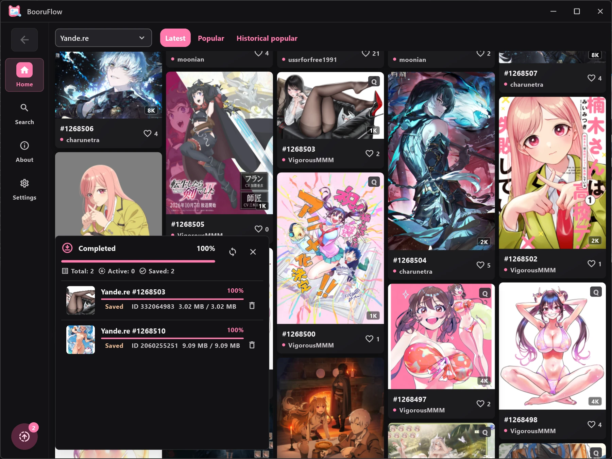
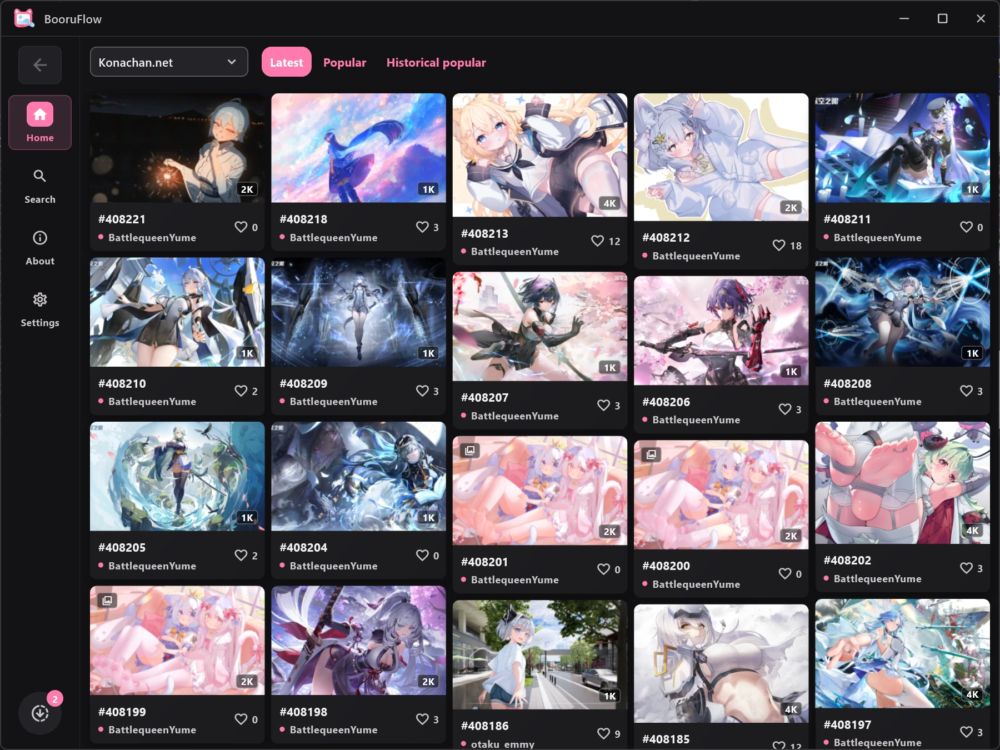
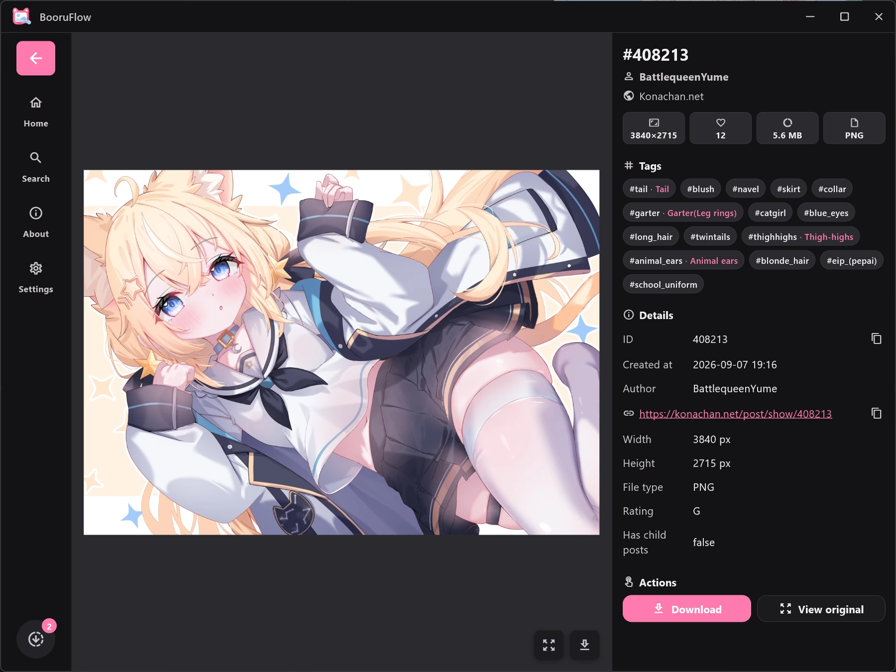
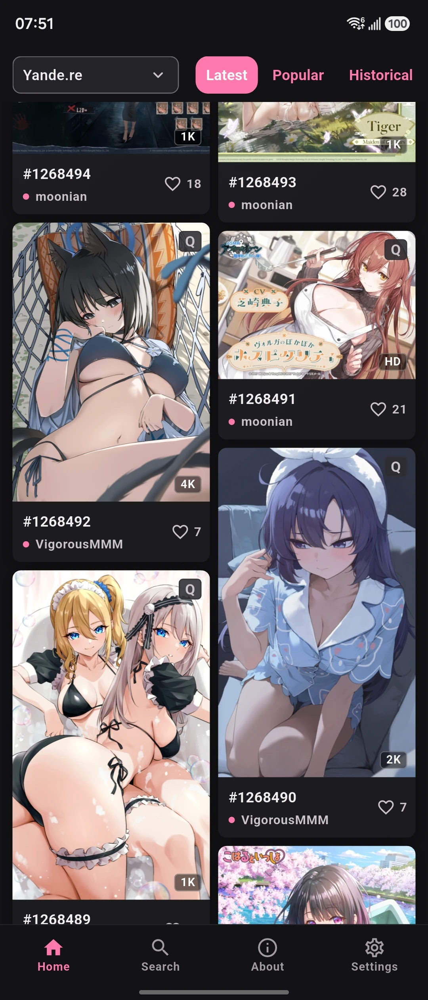
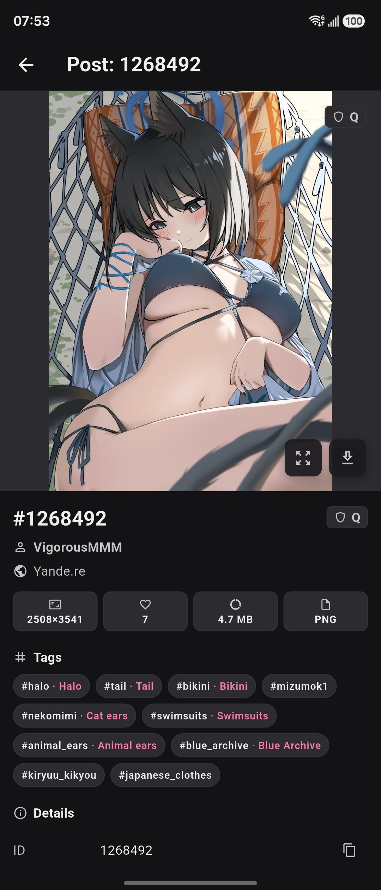

# BooruFlow

[English](README.md) | 简体中文

**开源的跨平台 Booru 图片浏览与下载工具。**

在 Android、Windows、Linux、macOS 和 iOS 上搜索、浏览与下载来自 Danbooru、Gelbooru、Yande.re 等图源的图片。

[下载最新版](https://github.com/normalllll/yande_gui/releases/latest) · [功能](#功能) · [截图](#截图)

## 功能

- **多个图源：** Yande.re、Konachan.net、Danbooru、AIBooru、Gelbooru、Wallhaven 和 Anime-Pictures。
- **搜索与发现：** 标签搜索、分级筛选、瀑布流，以及图源支持的热门图片。
- **图片详情：** 查看原图、标签、作者与来源、图片元数据和关联帖子。
- **下载管理：** 查看进度、暂停与继续任务、重试失败下载，并按图源整理文件。
- **账号与网络：** 按图源配置账号、代理和网络连接方式。
- **个性化：** 主题、布局设置、标签翻译，以及简体中文、繁体中文、英语和日语界面。

## 下载与安装

从 [GitHub Releases](https://github.com/normalllll/yande_gui/releases/latest) 下载安装包。

| 平台 | 安装包 | 安装说明 |
|---|---|---|
| Android | [app-arm64-v8a-release.apk](https://github.com/normalllll/yande_gui/releases/latest/download/app-arm64-v8a-release.apk) | 适合大多数当前手机；不确定架构时选择 [app-universal-release.apk](https://github.com/normalllll/yande_gui/releases/latest/download/app-universal-release.apk) |
| Windows | [windows-x64.zip](https://github.com/normalllll/yande_gui/releases/latest/download/windows-x64.zip) | 解压后运行应用 |
| Linux | [linux_amd64.deb](https://github.com/normalllll/yande_gui/releases/latest/download/linux_amd64.deb)、[linux_amd64.rpm](https://github.com/normalllll/yande_gui/releases/latest/download/linux_amd64.rpm) 或 [linux-x64.tar.gz](https://github.com/normalllll/yande_gui/releases/latest/download/linux-x64.tar.gz) | 按发行版选择。基于 Ubuntu 24.04 构建，旧系统可能缺少所需库 |
| macOS | [ARM64](https://github.com/normalllll/yande_gui/releases/latest/download/macos-arm64-nosigned.zip)、[x86_64](https://github.com/normalllll/yande_gui/releases/latest/download/macos-x86_64-nosigned.zip) | 分别为 Apple Silicon 和 Intel 构建，应用未经公证 |
| iOS | [ios-nosigned.ipa](https://github.com/normalllll/yande_gui/releases/latest/download/ios-nosigned.ipa) | 安装前需要自行签名；SOCKS5、HTTPS 和带认证的下载代理需要 iOS 17+ |

Android 另提供 ARM32 和 x86_64 安装包，各版本可用包以发行版附件为准。

图片加载失败时，先检查网络连接和图源的账号要求，再检查应用的网络设置；必要时可以尝试使用代理。

## 参与贡献

欢迎在 [Issues](https://github.com/normalllll/yande_gui/issues) 报告问题或提出建议。报告问题时，请提供平台、图源和复现步骤。也欢迎贡献代码、设计和翻译。

构建、测试和发布说明见[开发指南](DEVELOPMENT.md)。

## 社区

## 截图

### 桌面端

|  |  |
|--------------------------------------------------------|--------------------------------------------------------|

### 移动端

|  |  |
|------------------------------------------------------|------------------------------------------------------|

## 许可证

本项目采用 GNU General Public License v3.0，详见 [LICENSE](LICENSE)。
